# operacionesrest-cabecera-detalle

## Modelo Lógico

## Diagrama de Flujo

## Migraciones de base de datos

Antes de desplegar el estado `PAGADO_AL_CONTADO` en una base PostgreSQL existente,
ejecuta `database/migrations/postgresql/2026-11-25-add-pagado-al-contado.sql`.
Hibernate no actualiza automáticamente las restricciones `CHECK` existentes.